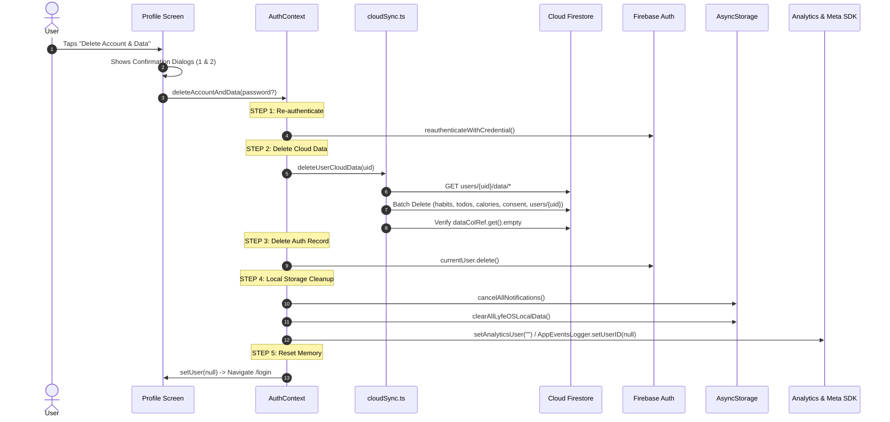
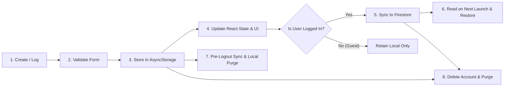

# LyfeOS Production Backend & Data Architecture Audit Report

**Audit Target:** LyfeOS Production Android App Codebase  
**Application ID:** `com.lyfeos.app`  
**EAS Project ID:** `54f639f6-a140-4168-afdc-eb3bca56979e`  
**Current App Version:** `2.2.1` (`versionCode: 35`)  
**Audit Date:** September 2026  
**Audit Scope:** Complete Read-Only Codebase & Configuration Audit  

---

## 1. Executive Summary

LyfeOS is architected as a **hybrid, local-first mobile application** built with React Native (Expo SDK 54) targeting Android. Rather than functioning as a thin client for a remote server, the application's single source of truth during execution is the device's local persistent storage via **AsyncStorage**. 

Cloud synchronization is implemented as a **secondary, unidirectional and opportunistic background layer** using **Firebase Cloud Firestore** (via `@react-native-firebase/firestore`). Only three user datasets are synchronized to Firestore:
1. Habits and habit completion logs (`users/{uid}/data/habits`)
2. To-do items (`users/{uid}/data/todos`)
3. Nutrition food items, water logs, and synchronization metadata (`users/{uid}/data/calories`)
4. Legal terms consent timestamp (`users/{uid}/data/consent`)

**Crucial Architectural Discoveries:**
1. **Partial Cloud Sync:** Health profiles (age, sex, height, weight, activity level, dietary goals), user display names, reminders, app preferences, sports/fitness workout logs, step logs, and coach insights are **stored 100% locally** in AsyncStorage. They are **never** backed up to Firebase Firestore or any remote cloud database. If a user uninstalls the app or switches devices, all fitness activities, steps, and profile metrics are lost.
2. **Offline Local Calculations (Gemini AI Discrepancy):** Despite documentation in `PROJECT_KNOWLEDGE.md` and server-side proxy code in `metro.config.js` and `server/serve.js` suggesting workout analysis is performed via Google Gemini 2.5 Flash, the actual client code in `utils/analyzeActivity.ts` executes a **100% offline, local MET (Metabolic Equivalent of Task) scientific calculation engine** with an artificial delay (`300ms–1200ms`) to simulate an AI network call. The mobile client never invokes Gemini in production.
3. **Logout State Leakage:** When a user logs out (`AuthContext.tsx` -> `signOut()`), `AsyncStorage` is **not cleared**. Local user data remains stored in plain text on the device filesystem. If a different user signs up or logs in on the same device, `handleGuestMigration()` in `AuthContext.tsx` reads the residual local data and **merges/migrates the previous user's data into the new account's Firestore collection**.
4. **No Firebase Storage or Realtime Database:** Neither Firebase Storage nor Realtime Database is used. Avatars chosen via the image picker are held exclusively in volatile React component state and discarded upon unmount.
5. **Absent Cloud Security Rules:** No `firestore.rules` or `firebase.json` files exist in the repository. Security rules are managed entirely out-of-band in the Google Firebase Console.

---

## 2. Technology Stack

### Frontend & Client Runtime
* **Framework:** React Native `0.81.5` / Expo SDK `~54.0.35`
* **Routing:** Expo Router `~6.0.24` (File-based routing)
* **Language:** TypeScript `~5.9.2`
* **State Management:** React Context API (`AuthContext`, `HabitsContext`, `TodosContext`, `CaloriesContext`, `ActivityContext`, `ProfileContext`, `ThemeContext`)
* **Local Persistence:** `@react-native-async-storage/async-storage` `2.2.0` (Plain-text SQLite/XML key-value store)
* **UI & Animations:** `react-native-reanimated` `~4.1.1`, `react-native-gesture-handler` `~2.28.0`, `react-native-svg` `15.12.1`
* **Hardware/Media Access:** `expo-image-picker` `~17.0.9`, `expo-av` `^16.0.8`, `expo-notifications` `^0.32.17`, `expo-haptics` `~15.0.8`

### Backend, Cloud & Third-Party Services
* **Authentication:** `@react-native-firebase/auth` `^24.1.1` (Email/Password, Google Sign-In, Anonymous Guest)
* **Cloud Database:** `@react-native-firebase/firestore` `^24.1.1`
* **Analytics & Telemetry:** `@react-native-firebase/analytics` `^24.1.1`, `react-native-fbsdk-next` `13.4.3` (Meta App Events)
* **Monetization:** `react-native-google-mobile-ads` `^16.3.3` (Google AdMob)
* **External Nutrition APIs:** USDA FoodData Central REST API (`api.nal.usda.gov`), Open Food Facts REST API (`world.openfoodfacts.org`)
* **Build & Updates:** EAS Build, Expo Updates (`https://u.expo.dev/54f639f6-a140-4168-afdc-eb3bca56979e`)

---

## 3. Backend Architecture Overview

```mermaid
flowchart TD
    subgraph MobileApp ["LyfeOS Android Client (com.lyfeos.app)"]
        UI["UI Screens (Expo Router)"]
        Context["React Context State Layer"]
        Storage["AsyncStorage (Private App Sandbox)"]
    end

    subgraph AuthLayer ["Authentication Layer"]
        FirebaseAuth["Firebase Authentication (lyfe-os-2c7cd)"]
        GoogleAuth["Google Play Services OAuth"]
    end

    subgraph CloudStorageLayer ["Cloud Database & Sync Layer"]
        Firestore["Cloud Firestore (lyfe-os-2c7cd)"]
        UsersCol["users/{uid}/data/*"]
    end

    subgraph ThirdPartyApis ["External Third-Party APIs"]
        USDA["USDA FoodData Central API"]
        OFF["Open Food Facts API"]
        AdMob["Google AdMob Network"]
        MetaSDK["Meta (Facebook) App Events"]
        FirebaseAnalytics["Firebase Analytics"]
    end

    UI --> Context
    Context <--> Storage
    UI -->|Sign In / Sign Up| AuthLayer
    GoogleAuth -->|OAuth ID Token| FirebaseAuth
    FirebaseAuth -->|UID Token| Context
    Context -->|Opportunistic Background Sync| Firestore
    Firestore --> UsersCol

    UI -->|Nutrition Text Search| USDA
    UI -->|Fallback Nutrition Search| OFF
    Context -->|Ad Trigger (every 3rd habit)| AdMob
    Context -->|Events & User ID| MetaSDK
    Context -->|Events & User ID| FirebaseAnalytics
```

### Complete End-to-End Topology
`Mobile App (React Native/Expo)`  
`  → Authentication (@react-native-firebase/auth + Google Sign-In)`  
`  → Backend/API (Direct Client SDK connection via gRPC / HTTPS)`  
`  → Database/Storage (Cloud Firestore: users/{uid}/data/*)`  
`  → External Third Parties (USDA API, Open Food Facts, Google AdMob, Meta SDK, Firebase Analytics)`

---

## 4. Firebase Services Used

| Firebase Product | Status | NPM Package / Integration | Evidence & Code Location |
| :--- | :--- | :--- | :--- |
| **Firebase Authentication** | **Active** | `@react-native-firebase/auth` `^24.1.1` | `[CONFIRMED]` `context/AuthContext.tsx:2` |
| **Cloud Firestore** | **Active** | `@react-native-firebase/firestore` `^24.1.1` | `[CONFIRMED]` `utils/cloudSync.ts:1`, `app/legal-consent.tsx:16` |
| **Firebase Analytics** | **Active** | `@react-native-firebase/analytics` `^24.1.1` | `[CONFIRMED]` `utils/analytics.ts:12` |
| **Firebase Storage** | **Not Used** | None (`@react-native-firebase/storage` not in `package.json`) | `[CONFIRMED]` Verified via `package.json:62-82` |
| **Realtime Database** | **Not Used** | None (`@react-native-firebase/database` not in `package.json`) | `[CONFIRMED]` Verified via `package.json:62-82` |
| **Cloud Functions** | **Not Used** | None (`@react-native-firebase/functions` not in `package.json`) | `[NOT FOUND]` No functions folder or package exists |
| **Crashlytics** | **Deferred / Inactive** | Stubs only in `utils/analytics.ts` (calls are safe no-ops) | `[CONFIRMED]` `utils/analytics.ts:8, 126-152` |

---

## 5. Authentication Architecture & User Identity

### 5.1 Sign-Up and Sign-In Mechanisms
* `[CONFIRMED]` **Email & Password:**
  * **Registration:** `context/AuthContext.tsx` -> `signUpWithEmail(name, email, password)` calls `auth().createUserWithEmailAndPassword(email, password)`, sets `result.user.updateProfile({ displayName: name })`, triggers `handleGuestMigration(result.user.uid)`, and logs the `sign_up` event.
  * **Login:** `context/AuthContext.tsx` -> `signInWithEmail(email, password)` calls `auth().signInWithEmailAndPassword(email, password)`, triggers `handleGuestMigration(result.user.uid)`, and logs the `login` event.
* `[CONFIRMED]` **Google Sign-In:**
  * Configured with web client ID `66808080139-r6t78lrsqsoabug2jlrltb1bbevt2003.apps.googleusercontent.com` (`context/AuthContext.tsx:39`).
  * `signInWithGoogle()` prompts native Google Play Services account picker, retrieves `idToken`, creates `auth.GoogleAuthProvider.credential(idToken)`, invokes `auth().signInWithCredential(googleCredential)`, triggers `handleGuestMigration()`, and logs `login` event.
* `[CONFIRMED]` **Anonymous Guest Sign-In:**
  * `signInAsGuest()` calls `auth().signInAnonymously()`. Generates an ephemeral anonymous user on Firebase Auth (`user.isAnonymous === true`).
* `[CONFIRMED]` **Password Reset:**
  * `app/login.tsx` -> `handlePasswordReset()` calls `auth().sendPasswordResetEmail(resetEmail.trim())`. Handled entirely by Firebase Auth mailers.

### 5.2 Firebase UID as Identity & Database Ownership Key
* `[CONFIRMED]` The Firebase Auth UID (`user.uid`) is the exclusive partition key for Cloud Firestore paths: `users/{uid}/data/*` (`utils/cloudSync.ts:5-6`).
* `[CONFIRMED]` `AuthProvider` listens to `auth().onAuthStateChanged` (`context/AuthContext.tsx:43`). When resolved, the user object is set into state and passed down through React Context.
* `[CONFIRMED]` `app/_layout.tsx:77` calls `setAnalyticsUser(user.uid)` and `setCrashlyticsUser(user.uid)`. `utils/analytics.ts:120` also transmits `user.uid` directly to Meta (Facebook) App Events via `AppEventsLogger.setUserID(userId)`.

### 5.3 Sign Out vs Account Deletion

#### Sign Out Flow (`AuthContext.tsx` -> `signOut()`)
* `[CONFIRMED]` Calls `await auth().signOut()` and `await GoogleSignin.signOut()`.
* **CRITICAL FINDING (`[CONFIRMED]`):** `signOut()` **does not invoke** `clearAllLyfeOSLocalData()`. All local data in `AsyncStorage` remains intact on the device.

#### Account Deletion Flow (`AuthContext.tsx` -> `deleteAccountAndData()`)
* `[CONFIRMED]` Implements a strict 5-step transactional sequence:
  1. **Re-authentication:** Enforces re-authentication before any destructive action. Email users must provide password (`reauthenticateWithEmail()`); Google users must perform interactive sign-in (`reauthenticateWithGoogle()`). If re-auth fails, execution aborts immediately.
  2. **Cloud Firestore Purge:** Invokes `deleteUserCloudData(uid)` in `utils/cloudSync.ts:243`. Fetches all documents under `users/{uid}/data/*`, queues batch deletions for all retrieved docs plus explicit docs (`habits`, `todos`, `calories`, `consent`), deletes the parent document `users/{uid}`, commits the batch, and asserts `dataColRef.get().empty`.
  3. **Firebase Auth Account Deletion:** Invokes `await currentUser.delete()`.
  4. **Local Data Wiping:** Calls `cancelAllNotifications()` and `clearAllLyfeOSLocalData()` (purging all `@lyfeos_` keys from AsyncStorage).
  5. **Telemetry Reset:** Clears `setAnalyticsUser("")` and `AppEventsLogger.setUserID(null)`.

---

## 6. Database Structure (Cloud Firestore)

Firestore in LyfeOS does **not** store items as individual documents (e.g. `users/{uid}/habits/{habitId}` does not exist). Instead, it adopts a **document-as-table array store** where all items of a domain are packed into an array inside a single document within the `data` subcollection.

### Verified Database Architecture
```
users/                         (Collection)
  └── {uid}/                   (Document - virtual container, no direct fields)
        └── data/              (Subcollection)
              ├── habits       (Document)
              ├── todos        (Document)
              ├── calories     (Document)
              └── consent      (Document)
```

### Complete Firestore Schema Mapping

| Data Entity | Cloud Location | Document ID Strategy | Document Fields & Types | Owner / UID Relationship |
| :--- | :--- | :--- | :--- | :--- |
| **Habits & Habit Logs** | `users/{uid}/data/habits` | Fixed document ID: `'habits'` | • `habits`: `Array<Habit>`<br>• `habitLogs`: `Array<HabitLog>`<br>• `updatedAt`: `FieldValue.serverTimestamp()`<br>• `migratedFromGuest`: `boolean` (optional) | Strictly scoped under `users/{uid}`. Private to authenticated user. |
| **To-do / Tasks** | `users/{uid}/data/todos` | Fixed document ID: `'todos'` | • `todos`: `Array<Todo>`<br>• `updatedAt`: `FieldValue.serverTimestamp()`<br>• `migratedFromGuest`: `boolean` (optional) | Strictly scoped under `users/{uid}`. Private to authenticated user. |
| **Nutrition & Water** | `users/{uid}/data/calories` | Fixed document ID: `'calories'` | • `calories`: `Map`<br>&nbsp;&nbsp;• `foodItems`: `Array<FoodItem>`<br>&nbsp;&nbsp;• `waterLogs`: `Array<WaterLog>`<br>&nbsp;&nbsp;• `lastModified`: `number` (timestamp ms)<br>• `updatedAt`: `FieldValue.serverTimestamp()`<br>• `migratedFromGuest`: `boolean` (optional) | Strictly scoped under `users/{uid}`. Private to authenticated user. |
| **Legal Consent Record** | `users/{uid}/data/consent` | Fixed document ID: `'consent'` | • `accepted`: `boolean`<br>• `version`: `string` (`"1.0"`)<br>• `timestamp`: `string` (ISO 8601) | Strictly scoped under `users/{uid}`. Private to authenticated user. |

### Global Collections & Cross-User Data Sharing
* `[CONFIRMED]` **No Global Collections:** Zero public or global collections (e.g., `public_data`, `global_settings`, `leaderboards`) exist in Firestore.
* `[CONFIRMED]` **No Sharing Mechanisms:** There are no collaboration, sharing, or multi-user read capabilities implemented in the codebase.

---

## 7. Complete User Data Inventory

| User Data Domain | Fields Collected | Storage Layers | Exact Code Files & Functions |
| :--- | :--- | :--- | :--- |
| **User Identity** | `uid`, `email`, `displayName` | Firebase Auth | `context/AuthContext.tsx` -> `signUpWithEmail()`, `signInWithEmail()`, `signInWithGoogle()` |
| **User Profile** | `userName`, `joinDate`, `habitGoal`, `activityGoal` | **Local AsyncStorage Only** (`@lyfeos_profile_name_v1`, `@lyfeos_profile_join_v1`, `@lyfeos_profile_habitgoal_v1`, `@lyfeos_profile_actgoal_v1`) | `context/ProfileContext.tsx` -> `setUserName()`, `setHabitGoal()`, `setActivityGoal()` |
| **Health Profile** | `age`, `sex`, `height`, `weight`, `activityLevel`, `goal` | **Local AsyncStorage Only** (`@lyfeos_profile_health_v1`) | `context/ProfileContext.tsx` -> `setHealthProfile()` |
| **User Preferences** | `units` (`metric`/`imperial`), `calorieDisplay` (`kcal`/`kj`), `habitEffectsEnabled`, theme mode | **Local AsyncStorage Only** (`@lyfeos_profile_prefs_v1`, `@lyfeos_theme_mode_v1`) | `context/ProfileContext.tsx` -> `setPreferences()`, `context/ThemeContext.tsx` |
| **Profile Avatar** | Local filesystem URI (`r.assets[0].uri`) | **Volatile Memory Only** (Lost on app reload) | `app/(tabs)/profile.tsx:427, 591-616` -> `handlePickAvatar()` |
| **Habits** | `id`, `name`, `type`, `trackMethod`, `colorId`, `emoji`, `targetAmount`, `targetTimeSeconds`, `weekDays`, `createdAt`, `description` | AsyncStorage (`@lyfeos_habits_v2`) + Firestore (`users/{uid}/data/habits`) | `context/HabitsContext.tsx` -> `addHabit()`, `updateHabit()`, `deleteHabit()`, `utils/cloudSync.ts:9` |
| **Habit Logs** | `id`, `habitId`, `date`, `completed`, `amount`, `timeSeconds` | AsyncStorage (`@lyfeos_habit_logs_v2`) + Firestore (`users/{uid}/data/habits`) | `context/HabitsContext.tsx` -> `logHabit()`, `utils/cloudSync.ts:9` |
| **To-do Items** | `id`, `title`, `completed`, `priority`, `category`, `dueDate`, `dueTime`, `notes`, `repeat`, `createdAt`, `order` | AsyncStorage (`@lyfeos_todos_v2`) + Firestore (`users/{uid}/data/todos`) | `context/TodosContext.tsx` -> `addTodo()`, `toggleTodo()`, `deleteTodo()`, `updateTodo()`, `reorderTodos()` |
| **Nutrition Logs** | `id`, `name`, `calories`, `carbs`, `protein`, `fat`, `fiber`, `sugar`, `sodium`, `meal`, `date`, `portionSize`, micronutrients (potassium, calcium, iron, vitamins) | AsyncStorage (`@lyfeos_food_v2`) + Firestore (`users/{uid}/data/calories`) | `context/CaloriesContext.tsx` -> `addFoodItem()`, `deleteFoodItem()`, `utils/cloudSync.ts:48` |
| **Water Intake** | `id`, `date`, `glasses` | AsyncStorage (`@lyfeos_water_v2`) + Firestore (`users/{uid}/data/calories`) | `context/CaloriesContext.tsx` -> `logWater()`, `utils/cloudSync.ts:48` |
| **Nutrition Daily Goals** | `calories`, `carbs`, `protein`, `fat`, `water` | **Local AsyncStorage Only** (`@lyfeos_goal_v2`, `@lyfeos_goals_configured_v1`) | `context/CaloriesContext.tsx` -> `setDailyGoal()` |
| **Sports & Activity Logs** | `id`, `date`, `sport`, `emoji`, `duration`, `intensity`, `caloriesBurned`, `hydrationNeededMl`, `hydrationGlasses`, `proteinNeededG`, `carbsNeededG`, `recoveryTimeHours`, `heartRateZone`, `healthBenefits`, `tips`, `postActivityMeal`, `sportCategory`, `steps` | **Local AsyncStorage Only** (`@lyfeos_activity_logs_v1`) | `context/ActivityContext.tsx` -> `addActivityLog()`, `deleteActivityLog()` |
| **Daily Steps Logs** | `date`, `steps`, `distanceKm`, `caloriesBurned`, `activeMinutes` | **Local AsyncStorage Only** (`@lyfeos_steps_v1`) | `context/ActivityContext.tsx` -> `logSteps()`, `getStepsForDate()` |
| **Activity Banner & Insights** | `sport`, `emoji`, `meal`, `loggedAt`, `text`, `generatedAt` | **Local AsyncStorage Only** (`@lyfeos_activity_banner_v1`, `@lyfeos_coach_insight_v1`) | `context/ActivityContext.tsx` -> `setPostActivityBanner()`, `setWeeklyCoachInsight()` |
| **Reminders & Notifications** | `morning`, `meal`, `water`, `evening` booleans; in-app notification inbox | **Local AsyncStorage & OS Alarms Only** (`@lyfeos_profile_reminders_v1`, `@lyfeos_notifications_v1`) | `context/ProfileContext.tsx` -> `setReminders()`, `utils/notifications.ts` |
| **Legal Consent** | `accepted`, `version`, `timestamp` | AsyncStorage (`legalConsent`) + Firestore (`users/{uid}/data/consent`) | `app/legal-consent.tsx:44-65` -> `handleContinue()` |
| **Ad / Usage Counters** | `habitCompletionCount`, `lastFoodSearchDate`, `foodSearchCount`, `activityLogCount` | **Local AsyncStorage Only** | `context/HabitsContext.tsx:186`, `utils/storage.ts:111-122` |

---

## 8. Data Flow by Feature

### 8.1 Authentication
1. **User Action:** Enters credentials or taps "Sign in with Google" on `app/login.tsx`.
2. **State Management:** Handled by `context/AuthContext.tsx`.
3. **Execution:** Invokes `@react-native-firebase/auth` (`signInWithEmailAndPassword` or `signInWithCredential`).
4. **Guest Migration Check:** `handleGuestMigration(uid)` reads local guest items (`@lyfeos_habits_v2`, `@lyfeos_todos_v2`, `@lyfeos_food_v2`, `@lyfeos_water_v2`) and batches writes to Firestore (`users/{uid}/data/*`).
5. **Telemetry:** Dispatches `login` event to Firebase Analytics and `fb_mobile_login` to Meta SDK; establishes user ID bindings via `setAnalyticsUser(uid)`.
6. **Routing:** `app/_layout.tsx` routes user through legal consent gate (`app/legal-consent.tsx`) into main tabs (`app/(tabs)/index.tsx`).

### 8.2 Habits
1. **User Action:** Creates or checks off a habit in `components/AddHabitSheet.tsx` or `components/HabitTile.tsx`.
2. **State Management:** Handled by `context/HabitsContext.tsx` (`addHabit` or `logHabit`).
3. **Local Write:** Generates unique ID (`Date.now() + random`), updates React state (`habits` or `habitLogs`), writes immediately to AsyncStorage (`@lyfeos_habits_v2` / `@lyfeos_habit_logs_v2`).
4. **Cloud Write:** Calls `utils/cloudSync.ts` -> `syncHabitsToCloud(uid, habits, habitLogs)`.
5. **Firestore Target:** `users/{uid}/data/habits` overwritten/merged via `.set({ habits, habitLogs, updatedAt }, { merge: true })`.
6. **Ad Trigger:** Every 3rd completion increments `habitCompletionCount` in AsyncStorage and triggers `showInterstitialAd()` from `utils/ads.ts`.

### 8.3 To-dos / Tasks
1. **User Action:** Adds, toggles, or reorders tasks in `app/(tabs)/todos.tsx`.
2. **State Management:** Handled by `context/TodosContext.tsx` (`addTodo`, `toggleTodo`, `reorderTodos`).
3. **Local Write:** Appends item with order index, writes immediately to AsyncStorage (`@lyfeos_todos_v2`).
4. **Cloud Write:** Calls `utils/cloudSync.ts` -> `syncTodosToCloud(uid, todos)`.
5. **Firestore Target:** `users/{uid}/data/todos` set via `.set({ todos, updatedAt })`.

### 8.4 Nutrition & Food Logging
1. **User Action:** Searches for a food item by text description in `app/(tabs)/calories.tsx`.
2. **Search Pipeline:** `utils/analyzeFoodImage.ts` -> `analyzeFoodText()` calls `utils/nutritionSearch.ts` -> `performNutritionSearch()`.
   * *Step A:* Checks local in-memory cache (`searchCache`).
   * *Step B:* Checks bundled Indian Food Database (`utils/indianFoodDatabase.ts`).
   * *Step C:* Dispatches query to USDA FoodData Central (`api.nal.usda.gov`).
   * *Step D:* Dispatches fallback query to Open Food Facts (`world.openfoodfacts.org`).
3. **User Selection:** User confirms meal slot (`breakfast`/`lunch`/`dinner`/`snacks`) and logs item.
4. **State Management:** `context/CaloriesContext.tsx` -> `addFoodItem()`.
5. **Local Write:** Updates React state, writes food array to `@lyfeos_food_v2`, records current timestamp ms in `@lyfeos_food_meta_v1`.
6. **Cloud Write:** Calls `utils/cloudSync.ts` -> `syncCaloriesToCloud(uid, { foodItems, waterLogs, lastModified })`.
7. **Firestore Target:** `users/{uid}/data/calories`.

### 8.5 Water Tracking
1. **User Action:** Taps `+` or `-` water glass button in `app/(tabs)/calories.tsx` or `app/(tabs)/index.tsx`.
2. **State Management:** `context/CaloriesContext.tsx` -> `logWater(date, delta)`.
3. **Local Write:** Modifies glass count in `@lyfeos_water_v2` and updates timestamp in `@lyfeos_food_meta_v1`.
4. **Cloud Write:** Bundled into `syncCaloriesToCloud()` and uploaded to `users/{uid}/data/calories`.

### 8.6 Fitness & Activity Logging
1. **User Action:** Submits workout form (sport, duration, intensity) in `components/ActivityTracker.tsx`.
2. **Calculation Pipeline:** Calls `utils/analyzeActivity.ts` -> `analyzeActivity()`.
   * Executes local scientific calculation based on Compendium of Physical Activities MET database.
   * Awaits simulated delay (`300ms–1200ms`).
   * Returns calculated calories, hydration, protein, carbs, recovery hours, heart rate zones, benefits, and tips.
3. **State Management:** Handled by `context/ActivityContext.tsx` -> `addActivityLog()`.
4. **Local Write:** Writes to `@lyfeos_activity_logs_v1`. Sets post-activity banner in `@lyfeos_activity_banner_v1`.
5. **Cloud Write:** **NONE.** No cloud synchronization occurs.

### 8.7 User Profile & Health Settings
1. **User Action:** Modifies personal name, weight, height, activity level, or reminders in `app/(tabs)/profile.tsx`.
2. **State Management:** Handled by `context/ProfileContext.tsx`.
3. **Local Write:** Saves to corresponding local keys (`@lyfeos_profile_name_v1`, `@lyfeos_profile_health_v1`, etc.).
4. **Cloud Write:** **NONE.** No cloud synchronization occurs.

---

## 9. Local Storage & Caching Architecture

### 9.1 AsyncStorage Key Registry (`utils/storage.ts`)

| AsyncStorage Key | Stored Data Type | Lifecycle & Persistence |
| :--- | :--- | :--- |
| `@lyfeos_food_v2` | `FoodItem[]` | Persistent until deleted or reset |
| `@lyfeos_water_v2` | `WaterLog[]` | Persistent until deleted or reset |
| `@lyfeos_goal_v2` | `DailyGoal` | Persistent until deleted or reset |
| `@lyfeos_goals_configured_v1` | `"true" \| "false"` | Persistent until deleted or reset |
| `@lyfeos_food_meta_v1` | `{ lastModified: number }` | Persistent until deleted or reset |
| `@lyfeos_habits_v2` | `Habit[]` | Persistent until deleted or reset |
| `@lyfeos_habit_logs_v2` | `HabitLog[]` | Persistent until deleted or reset |
| `@lyfeos_version` | `"v2_empty"` (Schema gate) | Persistent until version upgrade |
| `@lyfeos_todos_v2` | `Todo[]` | Persistent until deleted or reset |
| `@lyfeos_activity_logs_v1` | `ActivityLog[]` | Persistent until deleted or reset |
| `@lyfeos_steps_v1` | `StepsLog[]` | Persistent until deleted or reset |
| `@lyfeos_activity_banner_v1` | `PostActivityBanner \| null` | Auto-purged if older than 2 hours |
| `@lyfeos_coach_insight_v1` | `WeeklyCoachInsight \| null` | Persistent until deleted or reset |
| `@lyfeos_profile_name_v1` | `string` | Persistent until deleted or reset |
| `@lyfeos_profile_join_v1` | `string` (ISO timestamp) | Persistent until deleted or reset |
| `@lyfeos_profile_habitgoal_v1` | `string` (numeric) | Persistent until deleted or reset |
| `@lyfeos_profile_actgoal_v1` | `string` (numeric) | Persistent until deleted or reset |
| `@lyfeos_profile_health_v1` | `HealthProfile` | Persistent until deleted or reset |
| `@lyfeos_profile_reminders_v1` | `Reminders` | Persistent until deleted or reset |
| `@lyfeos_profile_prefs_v1` | `Preferences` | Persistent until deleted or reset |
| `@lyfeos_theme_mode_v1` | `"system" \| "dark" \| "light"` | Persistent until deleted or reset |
| `@lyfeos_notifications_v1` | `NotifItem[]` | Persistent until deleted or reset |
| `@lyfeos_notif_asked_v1` | flag string | Persistent until deleted or reset |
| `@lyfeos_rate_reminder_v1` | `RateReminderState` | Persistent until deleted or reset |
| `@lyfeos_confetti_date_v1` | date string | Persistent until deleted or reset |
| `legalConsent` | `{ accepted, version, timestamp }` | Persistent until consent version bump |
| `hasSeenOnboarding` | `"true"` | Preserved across resets |
| `habitCompletionCount` | `string` (numeric counter) | Incremented on habit completion |

### 9.2 Encryption & Storage Security Evaluation
* `[CONFIRMED]` **No Encryption at Rest:** AsyncStorage stores all values in unencrypted plain text within SQLite database files located in the private application folder (`/data/data/com.lyfeos.app/databases/RKStorage`).
* `[CONFIRMED]` **Intentional Disablement of Android Backup & D2D Migration:** In both `app.json` (`expo.android.allowBackup: false`) and `android/app/src/main/AndroidManifest.xml:20`, LyfeOS explicitly declares:
  ```xml
  android:allowBackup="false"
  ```
  * **Security & Privacy Rationale:** LyfeOS stores sensitive personal data locally (biometrics, health profiles, nutrition logs, workouts, habits, personal tasks). Disabling OS-level backup prevents unencrypted local database exposure, cross-account contamination on restored/shared devices, and resurrection of deleted data after account deletion.
  * **Restoration Architecture:** Local app data is never restored through Android OS backup or D2D transfer. Authenticated data restoration across devices is strictly handled via the existing Firestore cloud synchronization/hydration architecture upon login.
  * **Local Data Lifecycle:** Logout (`signOut`) and account deletion (`deleteAccountAndData`) remain responsible for actively clearing local device storage (`clearAllLyfeOSLocalData()`).

---

## 10. Data Synchronization Architecture

### 10.1 Synchronization Mechanism
* `[CONFIRMED]` **No Real-Time Firestore Listeners:** LyfeOS never calls `onSnapshot()`.
* `[CONFIRMED]` **One-Time Reads:** On initial mount, contexts read local `AsyncStorage` first, then execute a one-time `.get()` call to Firestore if the user is an authenticated non-guest.
* `[CONFIRMED]` **One-Time Fire-and-Forget Writes:** On every mutation, the app updates React state, writes to `AsyncStorage`, and immediately triggers `.set()` to Firestore in a non-blocking background promise.

### 10.2 Conflict Resolution Policies

#### Habits & Habit Logs (`utils/cloudSync.ts:62-101`)
* **Policy:** **Set-Union Deduplication.**
* Cloud and local habit arrays are combined. Habits with matching IDs or matching normalized names are deduplicated.
* For habit logs, logs sharing the same `habitId_date` key are merged, keeping `completed = true` if either was completed, and taking the maximum `amount` or `timeSeconds`.

#### To-dos (`context/TodosContext.tsx`, `utils/cloudSync.ts`)
* **Policy:** **Conflict-Aware Bidirectional Merge with Soft-Delete Tombstones (Highest updatedAt Wins, Delete-Wins on Ties).**
* `[CONFIRMED]` Both local and cloud lists are merged via `mergeTodos()`. Each todo includes `updatedAt: number` and optional `deletedAt?: number`.
* If a todo exists in both local and cloud, the newer `updatedAt` wins. On exact timestamp ties, deletion wins (`deletedAt` preserved).
* Soft-deleted tombstones are retained for 30 days (`TOMBSTONE_RETENTION_MS = 30 * 24 * 60 * 60 * 1000`) to propagate deletions to offline devices upon reconnection, after which they are purged.
* Recurring occurrences are deduplicated across devices using `seriesId` / `title + dueDate + repeat`.
* UI exposes only active items (`!t.deletedAt`).
* Pre-logout sync and guest migration both execute `mergeTodos` before saving.

#### Nutrition & Calories (`context/CaloriesContext.tsx:143-182`)
* **Policy:** **Timestamp-Guarded Last-Write-Wins.**
* Local metadata key `@lyfeos_food_meta_v1` tracks `lastModified` timestamp ms.
* If `cloudLastModified > localLastModified`, cloud data is accepted and written to AsyncStorage.
* If `localLastModified >= cloudLastModified`, local data is retained and automatically re-pushed to the cloud to repair stale remote records.

### 10.3 Behavior Under Environmental Transitions

1. **User changes data:** Immediate local state update + AsyncStorage write. If logged in, dispatches background Firestore `.set()`.
2. **Internet is available:** Background write succeeds transparently.
3. **Internet is unavailable:** Local write succeeds. Native Firebase SDK internally queues mutation; unhandled rejection is caught safely by `logError()`. UI operates seamlessly offline.
4. **Firebase request fails:** Error is logged; local state remains untouched and functional.
5. **App is restarted:** AsyncStorage is loaded synchronously into state. If authenticated, cloud record is fetched and merged.
6. **User logs out:** Firebase Auth session terminates; local data **persists in AsyncStorage**.
7. **User logs in on another device:**
   * Habits, to-dos, and calories download from Firestore.
   * Health profile, user name, goals, preferences, workout activities, and steps **do not download** because they are never synced. The new device initializes with empty/default profile and fitness values.

---

## 11. Security Rules Analysis

### 11.1 Repository Status
* `[CONFIRMED]` **No Security Rules in Codebase:** The repository does not contain `firestore.rules`, `storage.rules`, or `firebase.json`.
* `[STRONGLY INFERRED]` Security rules are configured and enforced directly within the Google Cloud / Firebase Console.

### 11.2 Evaluative Threat Assessment

| Question | Evaluation | Evidence & Rationale |
| :--- | :--- | :--- |
| **Who can read user data?** | Dependent on cloud rules; intended for document owner only | Code queries strictly scope to `users/{uid}/data/*`. |
| **Who can write user data?** | Dependent on cloud rules; intended for document owner only | Code writes strictly target `users/{uid}/data/*`. |
| **Can User A access User B's data?** | **Low Risk (if standard rules apply)** / **Critical Risk (if rules misconfigured)** | If cloud rules enforce `request.auth.uid == userId`, cross-tenant access is blocked. If default rules (`allow read, write: if true;`) were left active, anyone with the public API key can read/write any user document. |
| **Is access restricted via `request.auth.uid`?** | `[UNKNOWN]` (Server-side configuration) | Expected best-practice rule structure is `match /users/{userId}/{document=**} { allow read, write: if request.auth.uid == userId; }`. |
| **Are there any public collections?** | **None in code** | Code never queries top-level shared collections. |
| **Can unauthenticated users access anything?** | **No in-app calls** | `cloudSync.ts` is only invoked when `user && !isGuest`. Guest users never trigger Firestore network calls. |
| **Can authenticated users modify fields they shouldn't control?** | **High Risk** | No server-side schema validation exists (no Cloud Functions or strict rule assertions on document schemas). A malicious user could write arbitrarily large payloads or corrupt data structure in their document. |

---

## 12. Secrets & Credentials Audit

| Credential / Secret | Exact Location | Classification | Exposure Risk Assessment |
| :--- | :--- | :--- | :--- |
| **Firebase Android API Key** (`AIzaSy...`) | `google-services.json:39` | **Public Client Configuration** | **Low Risk:** Standard Firebase client key. Safe to embed in Android client; security is enforced via Firebase Security Rules. |
| **OAuth Web Client ID** (`66808080139-...apps.googleusercontent.com`) | `google-services.json:17, 33`, `context/AuthContext.tsx:39` | **Public Client Configuration** | **Low Risk:** Public OAuth client identifier for Google Sign-In. |
| **AdMob App ID & Ad Unit IDs** (`ca-app-pub-7658674851177824~...`) | `app.json:54`, `AndroidManifest.xml:21`, `utils/ads.ts:13-15` | **Public Client Configuration** | **Low Risk:** Public identifiers required for serving Google Mobile Ads. |
| **Meta (Facebook) App ID** (`1369488158633446`) | `app.json:77`, `strings.xml:7`, `.env.example:19` | **Public Client Configuration** | **Low Risk:** Standard public Facebook application identifier. |
| **Meta Client Token** (`baa4ccd5f752...`) | `app.json:78`, `strings.xml:8`, `.env.local:20` | **Client Secret / Token** | **Medium Risk:** Hardcoded in `app.json` and compiled into `strings.xml`. Used by Meta SDK for client verification. Should ideally be injected via secure build environment. |
| **USDA FoodData Central Key** (`DEMO_KEY`) | `.env.local:9`, `utils/nutritionSearch.ts:265` | **Public / Demo Key** | **Low Risk:** Fallback to public `DEMO_KEY` (rate-limited to 30 requests/hour/IP). |
| **Gemini API Key** (`GEMINI_API_KEY`) | `.env.local:14`, `metro.config.js:44`, `server/serve.js:28` | **Sensitive Server Secret** | **Safe from Client:** Not bundled into client APK (excluded from `EXPO_PUBLIC_`). Only accessed by Node.js server during web build or local dev proxy. |
| **Android Release Keystores** (`@shivam.2k__lyfeos.jks`) | Project Root: `@shivam.2k__lyfeos.jks`, `@shivam.2k__lyfeos_OLD_1.jks` | **Potentially Dangerous Credential** | **High Risk:** Production signing keystores are committed to local disk. While ignored in `.gitignore`, keeping production keys in project root creates severe risk of accidental repository commit or leakage. |

---

## 13. Third-Party Services & External Data Sharing

| Service | Data Transmitted | Purpose | Trigger Timing | Privacy & Compliance Risk |
| :--- | :--- | :--- | :--- | :--- |
| **Meta (Facebook) SDK** (`react-native-fbsdk-next`) | • Firebase Auth `UID`<br>• App events (`fb_mobile_login`, `CompletedRegistration`, `HabitCompleted`, `MealLogged`)<br>• Device Advertising ID | Attribution & ad conversion tracking | App initialization, sign in, habit completions, meal logging | **High Risk:** Transmits user ID and behavioural events to Meta. Requires explicit GDPR/CCPA disclosure and consent. |
| **Google AdMob** (`react-native-google-mobile-ads`) | • Google Advertising ID (`AD_ID`)<br>• Ad interaction telemetry | Monetization via Interstitial ads | Initialized 2s after launch; displays ad every 3rd habit completion | **Medium Risk:** Requests personalized ads (`requestNonPersonalizedAdsOnly: false`). Requires Google Play Data Safety declaration. |
| **USDA FoodData Central** (`api.nal.usda.gov`) | • Food search query string | Nutrition metadata resolution | When user types a food query not found in local DB | **Low Risk:** No PII or user identifiers transmitted. |
| **Open Food Facts** (`world.openfoodfacts.org`) | • Food search query string<br>• User-Agent: `"LyfeOS - Android - 1.0.0"` | Fallback nutrition resolution | When USDA search fails or yields 0 results | **Low Risk:** Public API lookup without user identifiers. |
| **Expo Application Services (EAS)** | • App runtime version<br>• Update check telemetry | Over-the-air (OTA) updates & crash telemetry | App startup (`EXPO_UPDATES_CHECK_ON_LAUNCH: ALWAYS`) | **Low Risk:** Standard application delivery telemetry. |

---

## 14. Account & Data Deletion Analysis



### Deletion Completeness Evaluation
* `[CONFIRMED]` **Authentication Record:** Permanently deleted from Firebase Auth.
* `[CONFIRMED]` **Firestore Cloud Data:** Permanently deleted via verified atomic batch write.
* `[CONFIRMED]` **Local Storage:** All `@lyfeos_` keys removed from AsyncStorage; notification alarms cancelled.
* `[CONFIRMED]` **Residual Data:** Historical analytics events in Firebase Analytics and Meta App Events are retained in aggregated telemetry.

---

## 15. Production vs Development Configuration

* `[CONFIRMED]` **Single Firebase Project:** Both development and production builds connect to the same Firebase project: `lyfe-os-2c7cd` (`google-services.json:4`). There is no environment isolation between development and production databases.
* `[CONFIRMED]` **EAS Build Channels:** `eas.json` configures four build profiles:
  * `development`: Internal distribution APK with dev client.
  * `preview`: Internal distribution APK for testing.
  * `production`: App Bundle (`.aab`) configured for Play Store Internal track submission.
  * `production-apk`: Direct APK build of production configuration.
* `[CONFIRMED]` **Web Deployment Domain:** In `eas.json:27`, `production.env.EXPO_PUBLIC_DOMAIN` is set to placeholder `"YOUR_DEPLOYED_DOMAIN_HERE"`. This variable is consumed only by `scripts/build.js` for static web exports and has no effect on native Android runtime.

---

## 16. Security Risks

1. **Unversioned Cloud Security Rules (`[UNKNOWN]` / High Risk):** Firestore rules are not maintained in the codebase. If the remote database has permissive read/write rules, any external party could compromise all user data.
2. **Plain-Text Local Storage (`[CONFIRMED]` / Low-to-Medium Risk):** AsyncStorage data is unencrypted on the filesystem. Android Auto Backup and D2D migration have been explicitly disabled (`android:allowBackup="false"`) in `app.json` and `AndroidManifest.xml` to eliminate OS-level backup extraction.
3. **Local Keystore Placement (`[CONFIRMED]` / High Risk):** Production keystores `@shivam.2k__lyfeos.jks` and `@shivam.2k__lyfeos_OLD_1.jks` sit directly in the root workspace.
4. **Hardcoded Meta Client Token (`[CONFIRMED]` / Low-to-Medium Risk):** Hardcoded in `app.json` line 78 and `strings.xml`.

---

## 17. Privacy & Data Handling Risks

1. **Logout Data Remanence (`[CONFIRMED]` / Critical Privacy Risk):** User data is not cleared on `signOut()`. On shared devices, a subsequent user will see the previous user's data, which `handleGuestMigration()` will then upload to the new user's cloud account.
2. **Third-Party UID Leakage to Meta (`[CONFIRMED]` / High Privacy Risk):** `utils/analytics.ts:120` passes the user's raw Firebase UID to Meta App Events via `AppEventsLogger.setUserID(userId)`.
3. **Partial Cloud Sync Data Loss (`[CONFIRMED]` / High Data Loss Risk):** Fitness activities, health profiles, and steps are purely local. Device replacement leads to permanent data loss without user warning.
4. **~~Naive Cloud Overwrite for To-dos~~ (`[REMEDIATED]`):** Previously in `TodosContext.tsx:61-66`, fetching cloud todos blindly overwrote local todos without a merge strategy. Remediated on 2026-09-10: Implemented `mergeTodos()` with per-todo `updatedAt`, soft-delete tombstones (`deletedAt`), 30-day retention, recurring occurrence deduplication, and delete-wins conflict resolution.

---

## 18. Recommended Improvements

1. **Purge AsyncStorage on Logout:** Update `AuthContext.tsx` -> `signOut()` to call `clearAllLyfeOSLocalData()` and `cancelAllNotifications()`.
2. **Sync Missing Domains to Firestore:** Extend `cloudSync.ts` to synchronize `healthProfile`, `activityLogs`, and `dailyGoal` under `users/{uid}/data/profile` and `users/{uid}/data/activity`.
3. **Implement Firestore Security Rules in Repo:** Create and version-control `firestore.rules` restricting read/write access:
   ```javascript
   rules_version = '2';
   service cloud.firestore {
     match /databases/{database}/documents {
       match /users/{userId}/{document=**} {
         allow read, write: if request.auth != null && request.auth.uid == userId;
       }
     }
   }
   ```
4. **[RESOLVED] Disable Insecure OS Backups:** `android:allowBackup="false"` is configured in `app.json` android configuration and `AndroidManifest.xml`.
5. **Relocate Production Keystores:** Move `.jks` files out of the project repository into secure offline/secret storage.
6. **Harmonize To-do Conflict Resolution:** Update `TodosContext.tsx` to adopt union-merge semantics identical to `HabitsContext.tsx`.

---

## 19. Architecture Diagrams

### 19.1 End-to-End System & Data Flow

```mermaid
graph TD
    User([End User]) -->|Interacts| App[LyfeOS Android App]

    subgraph Authentication
        App -->|Google Sign-In| GoogleOAuth[Google Play Services]
        GoogleOAuth -->|OAuth Token| FBAuth[Firebase Authentication]
        App -->|Email/Password| FBAuth
        FBAuth -->|Issue User UID| App
    end

    subgraph LocalStorage ["Device Private Storage"]
        App <-->|Read / Write| LocalStore[AsyncStorage]
        LocalStore --- HabitsLocal["@lyfeos_habits_v2"]
        LocalStore --- TodosLocal["@lyfeos_todos_v2"]
        LocalStore --- CaloriesLocal["@lyfeos_food_v2"]
        LocalStore --- ProfileLocal["@lyfeos_profile_* (LOCAL ONLY)"]
        LocalStore --- ActivityLocal["@lyfeos_activity_* (LOCAL ONLY)"]
    end

    subgraph BackendCloud ["Firebase Cloud Infrastructure"]
        App -.->|Background Sync| FirestoreDB[Cloud Firestore]
        FirestoreDB --> ColHabits["users/{uid}/data/habits"]
        FirestoreDB --> ColTodos["users/{uid}/data/todos"]
        FirestoreDB --> ColCalories["users/{uid}/data/calories"]
        FirestoreDB --> ColConsent["users/{uid}/data/consent"]
        FirestoreDB --> ColProfile["users/{uid}/data/profile"]
        FirestoreDB --> ColActivity["users/{uid}/data/activity"]
    end

    subgraph ThirdParties ["External Services"]
        App -->|Attribution & UID| MetaSDK[Meta App Events]
        App -->|Ad Requests & ID| AdMob[Google AdMob]
        App -->|Text Nutrition Search| USDA[USDA FoodData API]
        App -->|Fallback Search| OFF[Open Food Facts]
    end
```


### 19.2 Complete User Data Lifecycle


---

## 20. Primary Code & File References

* **Authentication & Identity:**
  * `context/AuthContext.tsx` -> `AuthProvider`, `signInWithGoogle()`, `signInWithEmail()`, `signUpWithEmail()`, `signOut()`, `deleteAccountAndData()`, `handleGuestMigration()`
  * `app/login.tsx` -> `LoginScreen`, `handleGoogleAuth()`, `handleEmailAuth()`, `handlePasswordReset()`
* **Cloud Database & Synchronization:**
  * `utils/cloudSync.ts` -> `getUserDoc()`, `syncHabitsToCloud()`, `syncTodosToCloud()`, `syncCaloriesToCloud()`, `syncProfileToCloud()`, `syncActivityToCloud()`, `syncAllUserDataBeforeLogout()`, `deleteUserCloudData()`, `mergeHabits()`, `mergeHabitLogs()`
  * `app/legal-consent.tsx` -> `handleContinue()`
* **Core Business Contexts:**
  * `context/HabitsContext.tsx` -> `HabitsProvider`, `addHabit()`, `logHabit()`, `maybeShowCompletionAd()`
  * `context/TodosContext.tsx` -> `TodosProvider`, `addTodo()`, `toggleTodo()`
  * `context/CaloriesContext.tsx` -> `CaloriesProvider`, `addFoodItem()`, `logWater()`, `setDailyGoal()`, `persistAndSync()`
  * `context/ActivityContext.tsx` -> `ActivityProvider`, `addActivityLog()`, `logSteps()`, `setWeeklyCoachInsight()`
  * `context/ProfileContext.tsx` -> `ProfileProvider`, `setHealthProfile()`, `setUserName()`, `setReminders()`, `setPreferences()`
* **Utilities, Storage & Telemetry:**
  * `utils/storage.ts` -> `LYFEOS_STORAGE_KEYS`, `clearAllLyfeOSLocalData()`, `setStoredJson()`, `getStoredJson()`
  * `utils/analytics.ts` -> `initializeMetaSDK()`, `logEvent()`, `setAnalyticsUser()`
  * `utils/ads.ts` -> `initializeAds()`, `showInterstitialAd()`, `AD_UNIT_IDS`
  * `utils/analyzeActivity.ts` -> `analyzeActivity()`, `ACTIVITY_DATABASE`
  * `utils/nutritionSearch.ts` -> `performNutritionSearch()`, `searchUSDA()`, `searchOpenFoodFacts()`
  * `utils/notifications.ts` -> `scheduleDailyNotifications()`, `cancelAllNotifications()`

---

## Where Does My User's Data Actually Live?

In simple, plain language:

* **Authentication & Identity:** Lives in **Firebase Authentication**. Your user's login credentials, email, password hashes, and unique user IDs (`UID`) are securely hosted by Google Firebase.
* **Habits & Habit Completion Logs:** Lives **both locally and in the cloud**. Stored locally on the phone in `AsyncStorage` (`@lyfeos_habits_v2`) and synchronized to Cloud Firestore at `users/{uid}/data/habits`.
* **To-dos & Tasks:** Lives **both locally and in the cloud**. Stored locally on the phone in `AsyncStorage` (`@lyfeos_todos_v2`) and synchronized to Cloud Firestore at `users/{uid}/data/todos`.
* **Nutrition Logs, Water Tracking & Daily Goals:** Lives **both locally and in the cloud**. Stored locally on the phone in `AsyncStorage` (`@lyfeos_food_v2`, `@lyfeos_water_v2`, `@lyfeos_goal_v2`) and synchronized to Cloud Firestore at `users/{uid}/data/calories`.
* **Legal Terms Acceptance:** Stored locally in `AsyncStorage` (`legalConsent`) and recorded in Cloud Firestore at `users/{uid}/data/consent`.
* **User Profile & Health Metrics (Age, Sex, Weight, Height, Fitness Goals, Preferences, Reminders):** Lives **both locally and in the cloud**. Stored locally on the phone in `AsyncStorage` (`@lyfeos_profile_*`) and synchronized to Cloud Firestore at `users/{uid}/data/profile`. Restored on login.
* **Fitness, Workouts & Sports Logs:** Lives **both locally and in the cloud**. Stored locally on the phone in `AsyncStorage` (`@lyfeos_activity_logs_v1`) and synchronized to Cloud Firestore at `users/{uid}/data/activity`. Restored on login.
* **Daily Steps & Walking Distance:** Lives **both locally and in the cloud**. Stored locally on the phone in `AsyncStorage` (`@lyfeos_steps_v1`) and synchronized to Cloud Firestore at `users/{uid}/data/activity`. Restored on login.
* **Profile Avatars & Images:** **Lives ONLY in volatile device memory.** Avatars are neither uploaded to Firebase Storage nor saved to persistent storage; they disappear when the app restarts.
* **AI Activity Analysis:** **Generated 100% on the phone.** No activity data is sent to Google Gemini servers; it is calculated offline via built-in exercise formula tables.
* **Behavioral Events & User ID:** Shared with **Google Firebase Analytics** and **Meta (Facebook)** for tracking, advertising attribution, and ad conversion. Cleared on logout and account deletion.

---

## Confidence Summary

| Audit Finding | Evidence Level | Primary Source Reference | Confidence |
| :--- | :--- | :--- | :--- |
| **Authentication Provider & Identity** | `[CONFIRMED]` | `context/AuthContext.tsx:2, 36-153` | **High** |
| **Firestore Subcollection Architecture** | `[CONFIRMED]` | `utils/cloudSync.ts:5-130`, `app/legal-consent.tsx:54-59` | **High** |
| **Health Profile & Activity Cloud Sync** | `[CONFIRMED]` | `context/ProfileContext.tsx`, `context/ActivityContext.tsx`, `utils/cloudSync.ts` | **High** |
| **Logout Data Isolation & Pre-Sync** | `[CONFIRMED]` | `context/AuthContext.tsx`, `app/(tabs)/profile.tsx` | **High** |
| **Gemini AI Replaced by Local Calculations** | `[CONFIRMED]` | `utils/analyzeActivity.ts:339-391` | **High** |
| **No Firebase Storage or Realtime DB** | `[CONFIRMED]` | `package.json:62-82` | **High** |
| **Plain-Text Local Storage & Backup Flag** | `[CONFIRMED]` | `utils/storage.ts`, `AndroidManifest.xml:20` | **High** |
| **Complete Account Deletion Sequence** | `[CONFIRMED]` | `context/AuthContext.tsx:179-236`, `utils/cloudSync.ts:237-284` | **High** |
| **Firestore Security Rules Configuration** | `[UNKNOWN]` | Absent from repository (hosted in Firebase Console) | **Low** |
| **Remote Database Environment Separation** | `[STRONGLY INFERRED]` | `google-services.json` (single project: `lyfe-os-2c7cd`) | **Medium** |
